<a href="https://routr.io"></a>

[](https://github.com/sponsors/fonoster) [](https://discord.com/invite/4QWgSz4hTC) 

Routr is a lightweight sip proxy, location server, and registrar that provides a reliable and scalable SIP infrastructure for telephony carriers, communication service providers, and integrators.

## Content

* [Community](#community)
* [Should you try Routr?](#should-you-try-routr)
* [Contact us](#contact-us)
* [Features](#features)
* [The official handbook](#the-official-handbook)
* [Deployment](#deployment)
    * [Docker](#instant-server-deployment-with-docker-and-compose)
    * [Kubernetes](#kubernetes)  
* [Getting started with the CTL](#getting-started-with-the-ctl)
* [First steps with the NodeSDK](#first-steps-with-the-nodesdk)
* [Custom Processors and Middleware](#building-custom-processors-and-middleware)
* [Documentation](https://docs.routr.io)
* [Bugs and feedback](#bugs-and-feedback)
* [Sponsors](#sponsors)
* [Contributing](#contributing)
    * [Dev Containers](#developing-with-dev-containers)
* [License](#license)

## Community

We are building Routr in the open. The best to communicate with us is via [GitHub Discussions.](https://github.com/fonoster/routr/discussions) You can also join our [Discord server](https://discord.com/invite/4QWgSz4hTC) to discuss roadmaps, feature requests, and more.

## Should you try Routr?

> Routr's architecture and design is fantastic. A breath of fresh air. Being Docker and Kubernetes ready is a huge win over a more traditional SIP server setup.
>
> [Phil Jones](https://www.linkedin.com/in/phil-jones-4346884a/), VP of Web Architecture at VQ Communications

> I came across Routr, which seems to be the one and only cloud-first Kubernetes-ready SIP server on the planet!
> 
> [Jessie Wadman](https://www.jessiewadman.se/), Cloud Architect @ Camanio AB

> Awesome and one of the best open-source software in 2023.
> 
> [no-championship-s368](https://www.reddit.com/r/linux/comments/11xdvo5/routr_v2_the_future_of_programmable_sip_servers/), Check conversation @ Reddit

> I think this project has a great promise to become a transformative technology.
> 
> [jbwill36](https://github.com/orgs/fonoster/discussions/209), Check conversation @ GitHub

## Contact us

Meet our sales team for any commercial inquiries.

<a href="https://cal.com/psanders"></a>

Carriers and SIP vendors can certify interop with Routr: see [interop/README.md](interop/README.md).

## Features

Routr's main features are:

- [x] Common SIP Server functions; Proxy, Registrar, Location Service
- [x] Programmable routing
- [x] Load balancing strategies against Media Servers like Asterisk and FreeSWITCH
- [x] Session Affinity 
- [x] Multi-Tenant/Multi-Domain with Domain level Access Control List
- [ ] Region-based routing
- [x] Configurable routing strategies; Intra-Domain, Domain Ingress, Domain Egress, and Peer Egress
- [x] No single point of failure
- [x] Transport: TCP, UDP, TLS, WS, WSS
- [x] In-memory and Redis Location Service 
- [x] JSON and YAML files as a data source
- [x] Postgres as a data source
- [x] Server management with the gRPC API
- [x] NodeSDK
- [x] Command-Line Tool
- [x] RTPEngine Middleware
- [x] Helm Chart for  Kubernetes Deployments
- [x] Endpoint Authentication with JWT (For web phones)
- [x] SDES-SRTP media toward TLS trunks (with RTPEngine)
- [x] Call message recording and replay
- [x] OpenTelemetry traces, metrics, and logs
- [ ] Support for STIR/SHAKEN
- [ ] Web Application

To learn more, read the [documentation](https://docs.routr.io) :books:

## The official handbook

<a href="https://fonoster.gumroad.com/l/the-future-of-programmable-sip-servers">
</a>

This handbook offers a detailed information about of the innovative features, challenges, and opportunities associated with using Routr.

Get the eBook.

* [Programmable, cloud-ready, open source](https://fonoster.gumroad.com/l/the-future-of-programmable-sip-servers)

## Give a star! ⭐

If you want to support this project, please give it a star. Thanks 🙏

## Deployment

### Instant server deployment with Docker and Compose

First, create a directory named "routr". Navigate into the new folder, and then copy the content below:

Filename: _compose.yaml_

```yaml
services:
  routr:
    image: fonoster/routr-one:latest
    environment:
      EXTERNAL_ADDRS: ${DOCKER_HOST_ADDRESS}
    ports:
      - 51908:51908
      - 5060:5060/udp
    volumes:
      - shared:/var/lib/postgresql/data

volumes:
  shared:
```

Then, start the server with:

```bash
# Be sure to replace with your IP address
DOCKER_HOST_ADDRESS=192.168.1.3 docker compose up
```

Alternatively, you can use the following command:

```bash
# Be sure to replace with your IP address
docker run \
  -p 51908:51908 \
  -p 5060:5060/udp \
  -e EXTERNAL_ADDRS=192.168.1.3 \
  fonoster/routr-one:latest
```

Wait a few seconds for the containers to initialize. Afterward, you can verify the status of the containers using:

```bash
docker ps -a --format 'table {{.ID}}\t{{.Image}}\t{{.Status}}'
```

You should see a container with the status "Up." It should look like the one below:

```bash
CONTAINER ID  IMAGE                                     STATUS
6c63fd573768  fonoster/routr-one:latest                 Up About a minute
```

If the status of your services is "Up," you are ready to go.

### Kubernetes

Routr can be installed in Kubernetes using Helm. The following instructions assume that you have a Kubernetes cluster up and running. 

> You can use Minikube or Docker Desktop to create a local Kubernetes cluster.

First, add the Helm repository:

```bash
helm repo add routr https://routr.io/charts
helm repo update
```

Then, create a namespace for Routr:

```bash
kubectl create namespace routr
```

Next, install Routr with the following command:

```bash
helm install my-release routr/routr-connect --namespace routr
```

Finally, wait a few minutes for the pods to start. You can check the status of the pods with the following command:

```bash
kubectl get pods -n routr
```

You should see a list of pods and their status. If the status is Running, then you are ready to go.

For more details, please refer to the chart's [README](https://github.com/fonoster/routr/blob/main/ops/charts/connect/README.md).

## Getting started with the CTL

Regardless of the deployment method, you can use the command-line tool to manage your server.

To install the command-line tool, run the following command:

```bash
npm install --location=global @routr/ctl
```

We are using the flag `--location=global` to tell npm to install the command-line tool globally. If you don't have npm installed, you can follow the instructions here: https://nodejs.org/en/download/.

Here is an example of how to create a domain:

```bash
rctl domains create --insecure
```

The `--insecure` flag, in the last example, is required because no certificate was provided to secure the API. 

Follow the prompts to create the domain.

The output should look like this:

```bash
This utility will help you create a new Domain.
Press ^C at any time to quit.
? Friendly Name Local Domain
? SIP URI sip.local
? IP Access Control List None
? Ready? Yes
Creating Domain Local Domain... a27e9fb2-a71a-4cf3-9b1d-dccf373f9777
```

For additional examples, refer to the command line [documentation.](https://www.npmjs.com/package/@routr/ctl)

## First steps with the NodeSDK

To begin using the Node.js SDK, first make sure you have Node and NPM installed. Then, start by creating a new project and installing the Routr Connect SDK.

```bash
mkdir my-project
cd my-project
npm init -y
```

Next, install the SDK:

```bash
npm install --save @routr/sdk
```

Now, create a new file called `index.js` and add the following code:

```javascript
const SDK = require("@routr/sdk");

const domains = new SDK.Domains();

const request = {
  name: "Local domain",
  domainUri: "sip.local",
  accessControlListRef: "4671371b-ff5d-48b1-aabe-d3c5ca5317a3", 
  egressPolicies: [{
    rule: ".*",
    numberRef: "4671371b-ff5d-48b1-aabe-d3c5ca5317a3"
  }],
  extended: {
    "key": "value"
  } 
};

domains.createDomain(request) 
  .then(console.log)
  .catch(console.error); // an error occurred
```

> In the example above, we assume that the ACL and Number already exist.

Now, go ahead and run the code:

```bash
node index.js
```

For complete documentation, please visit the npm page for `@routr/sdk` at https://www.npmjs.com/package/@routr/sdk

## Building custom Processors and Middleware

One of Routr's most significant advantages is that it is highly extensible. It enables you to create new Processors and Middleware to extend the functionality of your server.

Processors and Middleware services are responsible for modifying the SIP messages as they pass through the server. However, while both share the same interface, they serve different purposes.

Processors hold feature logic; Middlewares addresses cross-cutting concerns like authentication, authorization, rate limiting, etc.

The simplest possible Processor looks like this:

```javascript
const Processor = require("@routr/processor").default

new Processor({ bindAddr: "0.0.0.0:51904", name: "echo" }).listen(
  (req, res) => {
    console.log("got new request: ")
    console.log(JSON.stringify(req, null, " "))
    res.sendOk()
  }
)
```

The previous example is for a Processor that waits for a SIP message and then sends a 200 OK response. You can find the complete code [here](https://github.com/fonoster/routr/tree/main/mods/echo).

In addition to the previous example, you can check the following modules:

- [RTPRelay Middleware](https://github.com/fonoster/routr/tree/main/mods/rtprelay)
- [Simple Auth Middleware](https://github.com/fonoster/routr/tree/main/mods/simpleauth)
- [Processor Template](https://github.com/fonoster/nodejs-processor/tree/main)
- [Connect Processor](https://github.com/fonoster/routr/tree/main/mods/connect)

For more information about building Processors and Middleware, please refer to the [documentation.](https://docs.routr.io)

## Bugs and feedback

Report bugs in [GitHub Issues](https://github.com/fonoster/routr/issues). For questions and feature ideas, use [GitHub Discussions](https://github.com/fonoster/routr/discussions).

## Contributing

For contributing, please see the following links:

 - [Contribution Documents](https://github.com/fonoster/routr/blob/main/CONTRIBUTING.md)
 - [Contributors](https://github.com/fonoster/routr/contributors)

### Developing with Dev Containers

The repository includes a [Dev Container](https://containers.dev) with everything you need to build and run Routr: Node.js 22 and JDK 17, the same versions CI uses.

To get started, open the repository in VS Code and run **Dev Containers: Reopen in Container**, or use the CLI:

```bash
npx @devcontainers/cli@latest up --workspace-folder .
```

On first creation, the container generates the TLS keystore EdgePort expects and builds the project. The first build takes a while; later rebuilds reuse the cached `node_modules`, npm, and Gradle volumes.

Once it is ready, check the setup with the echo test. It starts EdgePort, the Dispatcher, and the Echo processor, sends a SIP `MESSAGE`, and expects a `200 OK`, with no database involved:

```bash
npm run test:echo
```

Postgres, Redis, and RTPEngine are not started up front. The commands that need them start them: `npm run start:one` brings up Postgres and Redis, migrates the database, and starts the all-in-one distribution. Set `RTPENGINE_HOST=rtpengine` to add RTPEngine. You can also start and stop them yourself with `npm run start:deps` and `npm run stop:deps`.

The SIP ports (5060-5063) and the service ports (51901-51908) are forwarded to your machine. For more, see the [dev containers guide](https://docs.routr.io/guides/develop-with-dev-containers).

> [!NOTE]
> VS Code only forwards TCP ports, so SIP over UDP from a softphone on your host will not reach the container. Use TCP or WebSocket instead.

<!--contributors:start-->

<table>
<tr>
    <td align="center" style="word-wrap: break-word; width: 150.0; height: 150.0">
        <a href=https://github.com/psanders>
            
            <br />
            <sub style="font-size:14px"><b>Pedro Sanders</b></sub>
        </a>
    </td>
    <td align="center" style="word-wrap: break-word; width: 150.0; height: 150.0">
        <a href=https://github.com/efraa>
            
            <br />
            <sub style="font-size:14px"><b>Efrain Peralta</b></sub>
        </a>
    </td>
    <td align="center" style="word-wrap: break-word; width: 150.0; height: 150.0">
        <a href=https://github.com/vikas-prasad-cx>
            
            <br />
            <sub style="font-size:14px"><b>Vikas Prasad</b></sub>
        </a>
    </td>
    <td align="center" style="word-wrap: break-word; width: 150.0; height: 150.0">
        <a href=https://github.com/vitalyster>
            
            <br />
            <sub style="font-size:14px"><b>vitalyster</b></sub>
        </a>
    </td>
    <td align="center" style="word-wrap: break-word; width: 150.0; height: 150.0">
        <a href=https://github.com/Hannarong98>
            
            <br />
            <sub style="font-size:14px"><b>Hannarong</b></sub>
        </a>
    </td>
    <td align="center" style="word-wrap: break-word; width: 150.0; height: 150.0">
        <a href=https://github.com/rafasc>
            
            <br />
            <sub style="font-size:14px"><b>rafasc</b></sub>
        </a>
    </td>
</tr>
<tr>
    <td align="center" style="word-wrap: break-word; width: 150.0; height: 150.0">
        <a href=https://github.com/kanimaru>
            
            <br />
            <sub style="font-size:14px"><b>Kani</b></sub>
        </a>
    </td>
    <td align="center" style="word-wrap: break-word; width: 150.0; height: 150.0">
        <a href=https://github.com/SemiConscious>
            
            <br />
            <sub style="font-size:14px"><b>SemiConscious</b></sub>
        </a>
    </td>
    <td align="center" style="word-wrap: break-word; width: 150.0; height: 150.0">
        <a href=https://github.com/BROWT190>
            
            <br />
            <sub style="font-size:14px"><b>Timmy</b></sub>
        </a>
    </td>
    <td align="center" style="word-wrap: break-word; width: 150.0; height: 150.0">
        <a href=https://github.com/luzpaz>
            
            <br />
            <sub style="font-size:14px"><b>luzpaz</b></sub>
        </a>
    </td>
</tr>
</table>

## Sponsors

We're glad to be supported by respected companies and individuals from several industries.

Find all our supporters [here](https://github.com/sponsors/fonoster)

> [Become a Github Sponsor](https://github.com/sponsors/fonoster)

## Authors

 - [Pedro Sanders](https://github.com/psanders)

## License

Copyright (C) 2026 by [Fonoster Inc](https://fonoster.com). MIT License (see [LICENSE](./LICENSE) for details).
